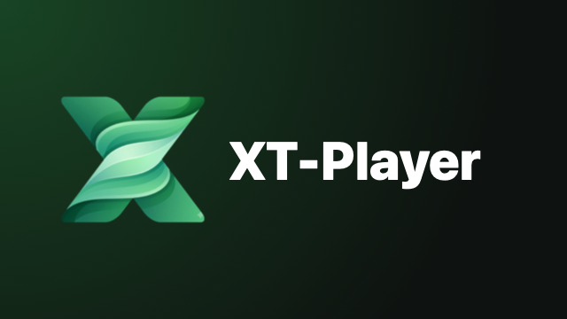

<p align="center">
  
</p>

<h1 align="center">XT-Player cho Android</h1>

<p align="center">
  Trình phát media cá nhân cho <b>điện thoại, máy tính bảng và Android TV box</b> — 4K · HDR10 · Dolby Vision · bitstream TrueHD / DTS-HD.<br>
  Bản chuyển từ <a href="https://github.com/xuanthanhtnt/XT-Player">XT-Player</a> (iPhone / iPad / Mac / Apple TV).<br>
  Lõi <b>Media3 ExoPlayer</b> + FFmpeg · giao diện <b>Jetpack Compose</b> · SMB2/3 <b>smbj</b>.
</p>

<p align="center">
  <a href="https://github.com/xuanthanhtnt/XT-Player-Android/actions/workflows/build.yml"></a>
</p>

---

## Tính năng

| Hạng mục | Android |
|---|---|
| Lõi phát | Media3 ExoPlayer 1.8 (MediaCodec giải mã phần cứng) + FFmpeg của Jellyfin cho TrueHD, DTS, DTS-HD… khi máy không có bộ giải mã |
| HDR | HDR10 / HLG / Dolby Vision xuất thẳng ra TV khi thiết bị hỗ trợ (không tone-map) |
| Âm thanh | **Bitstream AC3 / E-AC3 (Atmos) / DTS / DTS-HD / TrueHD qua HDMI** trên Android TV box (Apple TV không làm được); tắt được để giải mã sang PCM |
| Android TV | Có trên màn hình chính (banner), điều khiển hoàn toàn bằng remote (D-pad, OK, ◀▶ tua, phím media), **khớp tần số quét** (Match Content) |
| Ổ mạng | **SMB2/3** (liệt kê share, đọc trước 4 luồng + cache khối 1 MiB, tự kết nối lại khi NAS ngắt), **WebDAV** (HTTP/HTTPS, Basic/Digest, chứng chỉ tự ký), **tự tìm NAS** qua mDNS; ảnh thu nhỏ từng video khi duyệt thư mục; mật khẩu mã hoá bằng Android Keystore |
| Thư viện | Quét thư mục NAS, nhận diện phim / tập, poster, backdrop, diễn viên, tóm tắt, tên & ảnh từng tập từ **TMDb**; không có trên TMDb thì lấy khung hình trong video làm ảnh bìa; Tiếp tục xem, Mới thêm, Phim, TV Shows, Chưa xem, Điểm cao, Thể loại, Tìm kiếm (không cần gõ dấu) |
| Trình phát | Thanh điều khiển nổi, thanh tua (kéo / chạm / D-pad giữ để tua nhanh), bảng **Âm thanh · Phụ đề · Video · Thông tin**, phụ đề rời cạnh file trên NAS (.srt/.ass/.vtt), cỡ / vị trí / nền chữ, **tìm & tải phụ đề OpenSubtitles**, Up Next, tốc độ 0.5–2×, Fit / Fill / Stretch, chạm đúp để tua, picture-in-picture (điện thoại / tablet), MediaSession (phím media, Google Assistant) |
| Trakt | Đăng nhập bằng mã (cả trên TV), scrobble, đồng bộ đã xem và điểm xem tiếp với các thiết bị khác (gồm XT-Player trên Apple TV / iPhone / Mac và Infuse) |
| Mở tệp | Tệp trên máy / USB / thẻ nhớ (trình chọn tệp), URL http(s), "Mở bằng XT-Player" từ trình quản lý tệp / trình duyệt |
| Cập nhật | Tự kiểm tra GitHub Releases mỗi ngày, tải APK và mở trình cài đặt của Android |

### Khác bản Apple

- Chưa có: chương (chapter) của MKV, lệch phụ đề / lệch tiếng, ảnh xem trước khi tua, AirPlay (Android tương đương là Chromecast — để sau).
- Phụ đề ASS hiển thị kiểu cơ bản (ExoPlayer chưa có libass như libmpv).
- Một số định dạng cũ (WMV, RMVB, ISO, VOB) phụ thuộc thiết bị.

## Cài đặt

Tải `XT-Player-Android-x.y.z.apk` ở trang **Releases** (hoặc **Actions → Build → run mới nhất → Artifacts**).

- **Điện thoại / tablet**: mở file APK, cho phép "Cài ứng dụng không rõ nguồn gốc".
- **Android TV / Google TV / TV box**: cài app **Downloader** (AFTVnews) từ Play Store, nhập link APK; hoặc `adb install XT-Player-Android-x.y.z.apk`; hoặc chép APK qua USB và mở bằng trình quản lý tệp.

Yêu cầu Android 8.0 trở lên.

## Khoá API (tuỳ chọn)

- **TMDb**: lấy khoá miễn phí tại themoviedb.org ▸ Settings ▸ API, nhập vào **Cài đặt ▸ Thư viện** (nhận cả API key v3 lẫn Read Access Token v4).
- **OpenSubtitles**: API key tại opensubtitles.com ▸ Profile ▸ API Consumers → **Cài đặt ▸ Phụ đề trực tuyến**.
- **Trakt**: tạo ứng dụng tại trakt.tv/oauth/applications/new (Redirect URI `http://localhost`), dán Client ID vào **Cài đặt ▸ Trakt**, bấm **Kết nối Trakt** rồi nhập mã tại trakt.tv/activate.

CI có thể nhúng sẵn khoá qua GitHub secrets `TMDB_API_KEY`, `OPENSUBTITLES_API_KEY`, `TRAKT_CLIENT_ID`, `TRAKT_CLIENT_SECRET` (khoá khi đó nằm trong APK công khai — chỉ dùng khoá cá nhân).

## Build

Mọi bản build chạy trên **GitHub Actions** (`.github/workflows/build.yml`): chạy unit test, build APK release, đính kèm vào Artifacts; khi đẩy tag `v*` thì tự tạo Release kèm APK.

Ký APK: khoá phát hành (PKCS12) nằm ngoài repo, CI đọc từ các secret `ANDROID_KEYSTORE_BASE64` (`base64 -i release.keystore`), `ANDROID_KEYSTORE_PASSWORD`, `ANDROID_KEY_ALIAS`, `ANDROID_KEY_PASSWORD`. Build trên máy tự tìm `keystore.properties` trong dự án hoặc ở `~/.xtplayer-signing/`. **Giữ bản sao khoá cẩn thận**: mất khoá thì bản sau không cài đè được lên bản đã cài.

Build trên máy (cần JDK 17 và Android SDK):

```bash
./gradlew assembleDebug
```

Phát hành: tăng `versionCode` / `versionName` trong `app/build.gradle.kts` → commit → `git tag vX.Y.Z` → `git push origin main vX.Y.Z`.

## Cấu trúc

```
app/src/main/java/com/xuanthanhtnt/xtplayer/
├── XTPlayerApp.kt, MainActivity.kt   # Application (AppGraph), màn hình chính
├── core/          # AppSettings (SharedPreferences + StateFlow), SecureStore (Keystore), Http (Basic/Digest, TLS tự ký)
├── data/          # Room: MediaServer, LibraryFolder, LibraryItem, LibraryFile, MediaEntry; MediaLibrary, LibraryIndex
├── network/       # SMB (smbj + DCE/RPC), WebDAV (PROPFIND), mDNS
├── metadata/      # FilenameParser, TMDb, LibraryScanner, OpenSubtitles, ThumbnailStore
├── player/        # PlayerEngine (ExoPlayer), SmbFileReader / SmbDataSource, PlayerActivity, PlayerScreen (Compose)
├── trakt/         # Trakt: mã thiết bị, scrobble, đồng bộ
├── update/        # Cập nhật từ GitHub Releases
└── ui/            # Compose: Trang chủ, Thư viện, Chi tiết, Nguồn / duyệt NAS / thêm máy chủ, Cài đặt
```

## Giấy phép thành phần

Bộ giải mã FFmpeg (`org.jellyfin.media3:media3-ffmpeg-decoder`) dùng giấy phép GPLv3; smbj, Media3, OkHttp, Coil: Apache 2.0.
